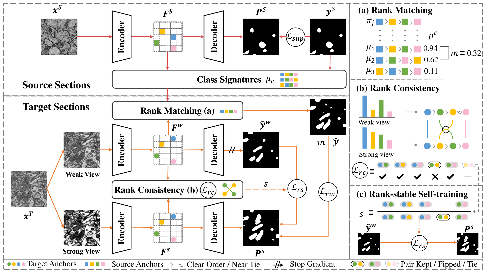

<div align="center">

# RIDA

### Rank-Invariant Domain Adaptation for Biomedical Image Segmentation

[Overview](#overview) · [Installation](#installation) · [Data](#data-preparation) · [Checkpoints](#checkpoints) ·
[Training](#training) · [Evaluation](#evaluation) · [Code structure](#code-structure)

</div>

---

## Overview

Unsupervised domain adaptation (UDA) adapts a segmentation model trained on a labeled source domain
to an unlabeled target domain. Existing supervision strategies, from explicit distribution
alignment to self-training with pseudo-labels filtered or weighted by confidence, are
*magnitude-based*: they rely on values (inputs, features, outputs or confidences) whose meaning is
assumed to carry over from one domain to the other. Biomedical domain shifts break this assumption.
CT and MR record different physical properties of tissue, and the contrast of electron microscopy
depends on the microscope and on how the specimen is prepared and stained, so the same structure
may appear bright in one domain and dark in the other.

What the two domains share is anatomy, and anatomy largely determines which structures a pixel
resembles more closely. A biomedical domain shift changes the similarities between a pixel and
different structures by amounts that differ across classes, but largely keeps their **order**.
**RIDA** builds the supervision for the target domain on this order rather than on magnitudes.
Every pixel is compared with a few **anchors** that represent the main structures of the images and
is described by its **ranking**, the order in which it resembles these anchors. A ranking stays the
same when the similarities rise or fall, as long as their order is kept, so supervision built on
rankings is unaffected by an order-preserving shift.

On top of the teacher-student scheme of self-training, RIDA has three components:

- **Rank consistency** ($\mathcal{L}_{rc}$) requires each target pixel to rank the anchors of its
  image in the same order in the weakly and strongly augmented views. The ranking is decomposed into
  pairwise comparisons between anchors, and only the pairs that the weak view separates clearly,
  the *trusted pairs*, are enforced.
- **Rank matching** ($\mathcal{L}_{rm}$) carries the source labels to the target domain. Each class
  is summarized by the average ranking of its labeled source pixels over source anchors, the *class
  signature*, and each target pixel is labeled with the class whose signature best matches its own
  ranking, weighted by the margin between the two best matches.
- **Rank-stable self-training** ($\mathcal{L}_{rs}$) weights each pseudo-label of the teacher by
  *rank stability*, the fraction of the trusted pairs of a pixel that keep their order from the weak
  view to the strong view, instead of by confidence.

Every pseudo-label in RIDA is thus assigned or weighted by order rather than by magnitude.

<p align="center">
  
</p>
<p align="center"><em>Overview of RIDA: (a) rank matching, (b) rank consistency, (c) rank-stable self-training.</em></p>

RIDA is evaluated on **eight biomedical benchmarks** with **three backbone families** — U-Net,
DINOv3 ViT-L/16 and MedSAM ViT-B with LoRA adapters, 24 adaptation settings in total — covering
cross-modality abdominal and cardiac segmentation (CT ⇄ MR in both directions) and cross-species
mitochondria segmentation in electron microscopy (VNC III → Lucchi on two subsets, MitoEM human ⇄
rat).

## Installation

```bash
conda create -n rida python=3.11 -y
conda activate rida
pip install torch==2.5.1 torchvision==0.20.1 --index-url https://download.pytorch.org/whl/cu124
pip install -r requirements.txt
```

The DINOv3 and Segment Anything sources are vendored in `third_party/` and imported from there.
The foundation-model weights are obtained from their official releases:

| File | Model | Source |
|---|---|---|
| `pretrained/dinov3_vitl16_pretrain_lvd1689m.pth` | DINOv3 ViT-L/16, LVD-1689M | <https://github.com/facebookresearch/dinov3> |
| `pretrained/medsam_vit_b.pth` | MedSAM ViT-B | <https://github.com/bowang-lab/MedSAM> |

`scripts/download_pretrained.sh` checks both files and downloads them when `DINOV3_URL` / `MEDSAM_URL` are set.

## Data preparation

### Sources

| Task | Dataset | Modality | Link |
|---|---|---|---|
| Abdominal | **BTCV** — Multi-Atlas Labeling Beyond the Cranial Vault | CT | <https://www.synapse.org/#!Synapse:syn3193805> |
| Abdominal | **CHAOS** — Combined Healthy Abdominal Organ Segmentation | MR | <https://chaos.grand-challenge.org/> |
| Cardiac | **MM-WHS 2017** — Multi-Modality Whole Heart Segmentation | CT, MR | <https://zmiclab.github.io/zxh/0/mmwhs/> |
| VNC III → Lucchi | **Drosophila VNC III** ssTEM | EM | <https://github.com/unidesigner/groundtruth-drosophila-vnc> |
| VNC III → Lucchi | **EPFL Lucchi** hippocampus | FIB-SEM | <https://www.epfl.ch/labs/cvlab/data/data-em/> |
| MitoEM | **MitoEM-H / MitoEM-R** | EM | <https://mitoem.grand-challenge.org/> |

| Task | Classes |
|---|---|
| Abdominal | background, spleen, right kidney, left kidney, liver |
| Cardiac | background, ascending aorta (AA), left atrium cavity (LAC), left ventricle cavity (LVC), myocardium (MYO) |
| VNC III → Lucchi, MitoEM | background, mitochondria |

### Layout

The settings read 2-D slices stored as `.npz` files with an `image` and a `label` array, named
`<case>_<slice index>.npz`; the case prefix groups slices into volumes for the volumetric
evaluation. The U-Net settings of VNC III → Lucchi and MitoEM read the original EM stacks
(`data/em_volumes`).

```
data/
├── abdominal/
│   ├── CT/{train,test}/*.npz            BTCV
│   └── MR/{train,test}/*.npz            CHAOS
├── cardiac/
│   ├── CT/{train,test}/*.npz            MM-WHS CT
│   └── MR/{train,test}/*.npz            MM-WHS MR
├── em/
│   ├── vnc/train/*.npz                  VNC III
│   ├── lucchi_subset1/{train,test}/     Lucchi, training stack -> test stack
│   ├── lucchi_subset2/{train,test}/     Lucchi, test stack -> training stack
│   ├── mitoem_human/{train,test}/       MitoEM-H
│   └── mitoem_rat/{train,test}/         MitoEM-R
└── em_volumes/
    ├── VNC3/{training,training_groundtruth}/*.png, train.txt
    ├── Lucchi/{training,training_groundtruth,testing,testing_groundtruth}/*.png, train.txt, testing.txt
    └── MitoEM/{human,rat}/{training,training_groundtruth,testing,testing_groundtruth}.hdf
```

```bash
bash scripts/data/check.sh          # verifies the layout of all 24 settings
```

## Checkpoints

One RIDA checkpoint is provided per setting on [Hugging Face](https://huggingface.co/jiajianihao/RIDA):

```bash
huggingface-cli download jiajianihao/RIDA --local-dir checkpoints --include "rida/*"
```

The files are placed at `checkpoints/rida/<benchmark>/<setting>.pth`, where `<setting>` is
`<backbone>_<direction>`, e.g. `checkpoints/rida/cardiac/dinov3_ct2mr.pth`.

## Training

Every setting is described by one configuration, `configs/rida/<backbone>/<benchmark>_<direction>.yaml`,
which inherits from `configs/base`, and is trained in a single end-to-end run with one command:

```bash
python tools/train.py configs/rida/unet/cardiac_ct2mr.yaml
python tools/train.py configs/rida/dinov3/mitoem_h2r.yaml --work-dir work_dirs/mitoem/dinov3_h2r
```

The backbone, the data pipeline and the evaluation protocol are selected from the configuration.

Benchmark scripts:

```bash
bash scripts/train/abdominal.sh                       # all six abdominal settings
bash scripts/reproduce/cardiac.sh                     # training + evaluation of the cardiac settings
GPU=3 bash scripts/reproduce/mitoem.sh dinov3_h2r     # a single setting on GPU 3
GPUS="0 1 2 3 4 5" bash scripts/train/multi_gpu.sh vnc2lucchi
bash scripts/reproduce/all.sh                         # all 24 settings and a summary table
```

A run writes `work_dirs/<benchmark>/<setting>/` with the resolved configuration, training logs
(`logs/metrics.jsonl`, `logs/train.log`) and checkpoints (`best.pth`, `latest.pth`). An interrupted
run resumes from `latest.pth` when the same command is issued again; `tools/export_checkpoint.py`
converts `best.pth` into a release checkpoint.

## Evaluation

```bash
python tools/test.py configs/rida/unet/cardiac_ct2mr.yaml checkpoints/rida/cardiac/unet_ct2mr.pth
bash scripts/test/all.sh                     # every released checkpoint + summary table
```

`tools/test.py` applies the protocol of the benchmark of the configuration:

| Task | Metrics |
|---|---|
| Abdominal, Cardiac | Dice (%) and ASSD (voxels) per organ and their mean, on the target test volumes |
| VNC III → Lucchi, MitoEM | mAP, F1, MCC and IoU (%) of the mitochondria class, on the target test stack |

Predictions are written by `tools/infer.py`:

```bash
python tools/infer.py configs/rida/medsam/abdominal_ct2mr.yaml checkpoints/rida/abdominal/medsam_ct2mr.pth \
    work_dirs/predictions/abdominal_medsam_ct2mr
python tools/infer.py configs/rida/unet/mitoem_h2r.yaml checkpoints/rida/mitoem/unet_h2r.pth \
    work_dirs/predictions/mitoem_unet_h2r
```

## Code structure

```
RIDA
├── configs
│   ├── rida
│   │   └── <backbone>             <benchmark>_<direction>.yaml: entry configuration of a setting
│   └── base                       configurations inherited by the entry configurations
│       ├── base.yaml              shared by all settings
│       └── <backbone>             <backbone>.yaml and <benchmark>_<direction>.yaml
├── rida
│   ├── core                       anchors, rank consistency / stability, rank matching, self-training losses
│   ├── models                     U-Net, DINOv3 segmentor, MedSAM segmentor with LoRA
│   ├── datasets                   .npz slices, paired EM slices, augmentations
│   ├── trainers                   end-to-end training loop and one trainer per backbone family
│   ├── evaluation                 volumetric Dice / ASSD, mitochondria metrics
│   ├── apis                       training, inference and evaluation interfaces
│   └── utils                      configuration, checkpoints, schedules, logging
├── assets                         method figure
├── tools                          train / test / infer entry points, checkpoint export, data check
├── scripts                        per-benchmark training, reproduction and evaluation scripts
├── third_party                    DINOv3, Segment Anything (MedSAM license)
├── pretrained                     foundation-model weights
├── checkpoints                    RIDA checkpoints
└── data                           datasets
```

## Acknowledgements

The project builds on [DINOv3](https://github.com/facebookresearch/dinov3),
[Segment Anything](https://github.com/facebookresearch/segment-anything),
[MedSAM](https://github.com/bowang-lab/MedSAM) and the open-source domain-adaptive segmentation
codebases [DAFormer](https://github.com/lhoyer/DAFormer) and [DA-ISC](https://github.com/weih527/DA-ISC). We thank the authors of BTCV, CHAOS, MM-WHS,
VNC III, Lucchi and MitoEM for releasing their data.

## License

Released under the [MIT License](LICENSE). The vendored third-party code keeps its own license
(`third_party/*/LICENSE*`).
